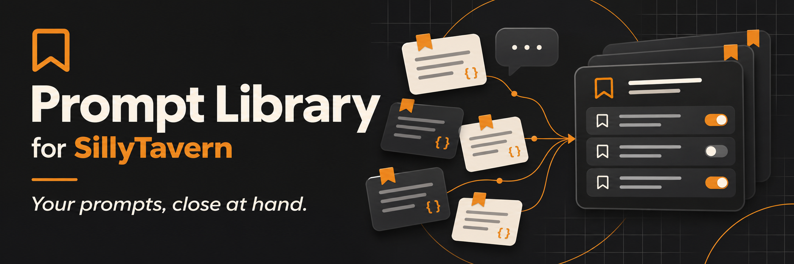
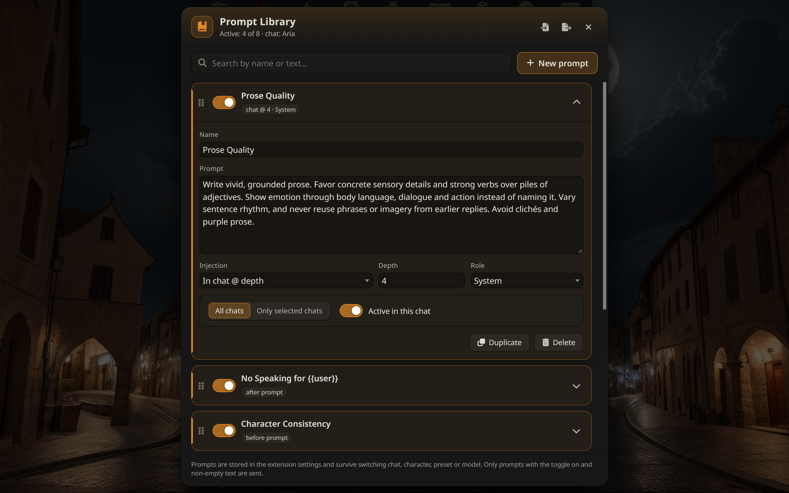
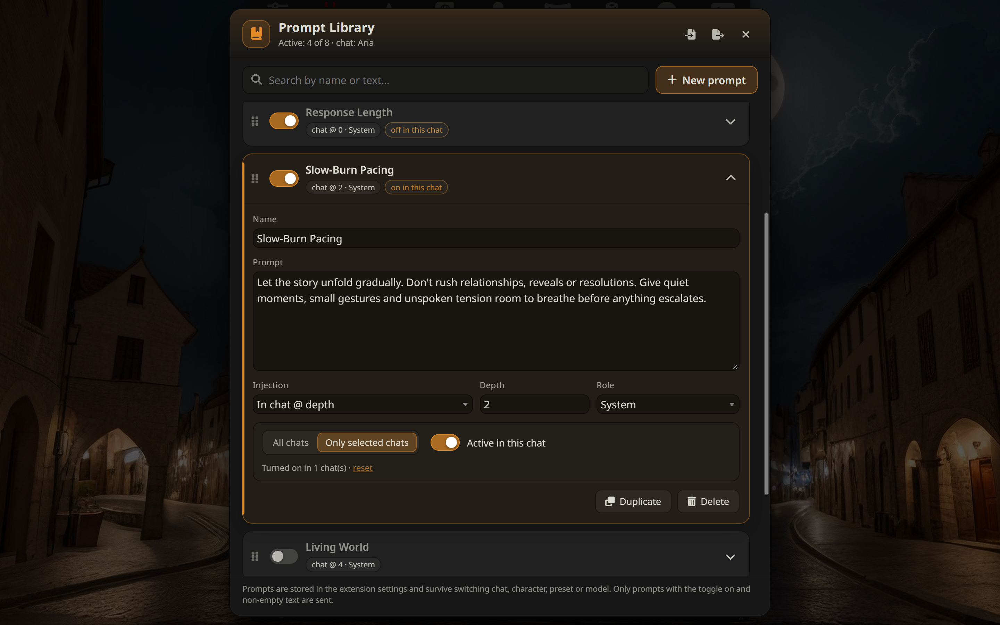
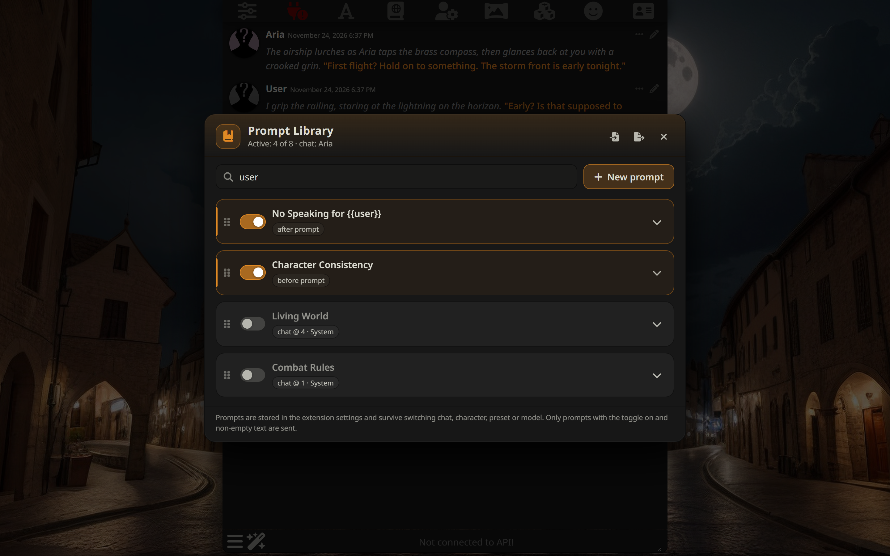
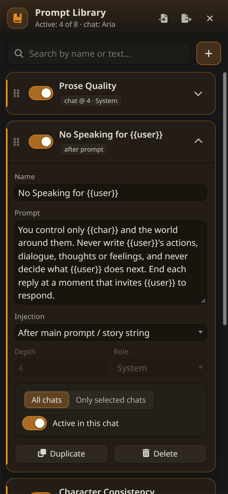

<p align="center"><strong>English</strong> · <a href="README.ru.md">Русский</a></p>



<p align="center">
  
  
  
  
  <a href="https://t.me/deadsum"></a>
</p>

I got tired of digging through notes for my prompts, so I made Prompt Library to keep them close at hand. Save a prompt as a note, or switch it on to inject it into the conversation. Everything you need is in SillyTavern, ready when you need it.

Your library stays in the extension settings when you switch chats, characters, presets, APIs, or models.

<p align="center"><a href="#install">Install</a> · <a href="#quick-start">Quick start</a> · <a href="#screenshots">Screenshots</a> · <a href="#how-prompts-are-inserted">How it works</a></p>


## What you can do

| Prompt settings | Library tools |
| :--- | :--- |
| **Choose where each prompt goes.** Insert it at a specific chat depth, before the main prompt, or after it. Set a role for entries placed in chat. | **Organize your library.** Add, duplicate, delete with confirmation, drag to reorder, and search by name or prompt text. |
| **Control which chats use it.** Apply an entry to all chats, exclude individual chats, or enable it only in selected chats. | **Export and import JSON.** Transfer your library without its per-chat settings. |
| **Use SillyTavern macros.** Entries support `{{char}}`, `{{user}}`, and other macros. | **Use it on desktop or mobile.** The interface follows your SillyTavern theme and opens full screen on phones. |

## Install

Tested on **SillyTavern 1.19.0**.

Open **Extensions → Install extension** and paste:

```text
https://github.com/Sumo1433/SillyTavern-Prompt-Library
```

## Quick start

1. Open **🪄 → Prompt Library**.
2. Expand **Your Prompt**, or select **New prompt**.
3. Enter a name and prompt text.
4. Choose the injection position, depth, and role.
5. Switch the entry on.

The entry will be included in requests for chats where it is active. Entries that are switched off or contain no text are not sent. To keep a prompt as a note, leave it switched off.

New entries use your Author’s Note defaults. If you have not changed those defaults, the position is **In chat @ depth 4**, with the **System** role.

### Choose your chats

Entries apply to **All chats** by default.

To exclude the current chat, turn off **Active in this chat** in the entry editor.

To use an entry in just a few chats, select **Only selected chats**. Open each chat you want to include and turn on **Active in this chat**.

Card badges show chat-specific status. Chat assignments are preserved when a chat is renamed, and a new branch or checkpoint inherits the settings of the chat it was created from the first time you open it.

## Screenshots

The screenshots show example prompts. On first launch, the library contains one empty, disabled entry named **Your Prompt**.

| Prompt editor | Per-chat settings |
| :---: | :---: |
| [](docs/screenshots/en-desktop-editor.png) | [](docs/screenshots/en-desktop-per-chat.png) |

<details>
<summary>Search and wand menu</summary>



<p align="center"></p>

</details>

<details>
<summary>Mobile library and editor</summary>

<p align="center">
  
  
</p>

</details>

## How prompts are inserted

Prompt Library uses SillyTavern’s built-in `setExtensionPrompt` mechanism, also used by Author’s Note. It works with **Chat Completion** and **Text Completion**, including presets with Main Prompt disabled.

| Position | Placement | Role |
| :--- | :--- | :--- |
| In chat @ depth | At the chosen depth. Depth 0 places the entry after the last message. | System, User, or Assistant |
| Before main prompt / story string | Before the main prompt or story string. | Always System |
| After main prompt / story string | After the main prompt or story string. | Always System |

### Ordering and storage

- Entries at the same chat depth with the same role are combined into one block in library order. Entries before or after the main prompt are grouped by position.
- This grouping keeps entry order consistent between Chat Completion and Text Completion.
- At the same chat depth, SillyTavern places roles in the order **System → User → Assistant**, regardless of library order.
- The library is stored in your user’s `settings.json` on the SillyTavern server.
- JSON exports do not include per-chat settings.

## Interface languages

**English · Русский · Українська · 简体中文**

The extension follows your SillyTavern interface language. Traditional Chinese uses the Simplified Chinese translation; other unsupported languages fall back to English.

## Author and license

Created by **SumoNoir**. Telegram: [@deadsum](https://t.me/deadsum).

Licensed under [MIT](LICENSE).
