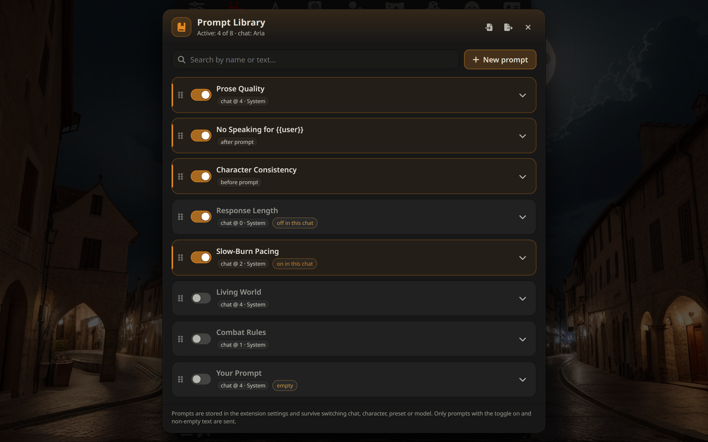
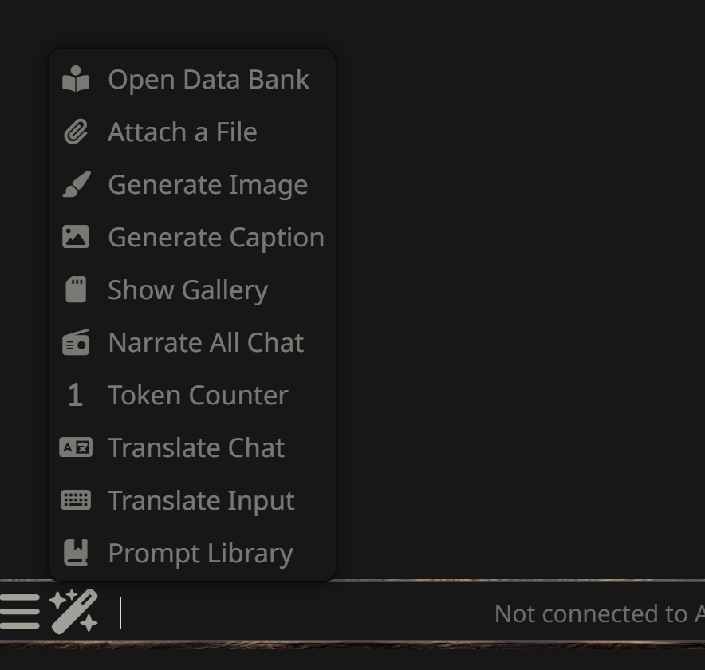
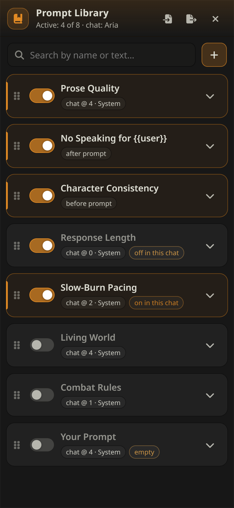

# Prompt Library for SillyTavern

[Русский](README.ru.md)

A library of your own prompts. Think of it as Author's Note with as many entries as you like, all kept in one place. Prompts live in the extension settings, so switching chat, character, preset, API or model never loses them.

## Features

- A dedicated window from the wand menu (🪄 → **Prompt Library**).
- Each entry has a **toggle**, **name**, **prompt text**, **injection type**, **depth** and **role**.
  - *In chat @ depth N*: same as Author's Note (0 = after the last message).
  - *Before* or *after* the main prompt / story string.
- On first run the library holds one empty, switched-off entry called **Your Prompt**. New entries use the same injection defaults as Author's Note (in chat, depth 4, System, or whatever you set as Author's Note defaults).
- An entry that is switched off or has empty text is **never sent**.
- Entries apply to **all chats** by default. The editor has an “Active in this chat” toggle to turn an entry off just here. “Only selected chats” mode limits an entry to the chats you tick.
- Add, duplicate, delete, drag to reorder, and search by name or text.
- Export and import the library as JSON (per-chat settings are not exported).
- Macros such as `{{char}}` and `{{user}}` work.
- The UI follows the SillyTavern language: English, Russian, Ukrainian, Chinese (Simplified; Traditional Chinese also gets Simplified).
- Colors come from your active theme, and on phones the window opens full screen.

## Install

Extensions → Install extension → paste:

```
https://github.com/Sumo1433/SillyTavern-Prompt-Library
```

## How it works

The extension uses SillyTavern's built-in `setExtensionPrompt`, the same mechanism as Author's Note. That's why it works with Chat Completion and Text Completion and with any preset. Even if the preset disables Main Prompt, the before/after main prompt positions still land in place.

## Notes

- Entries with the same injection type, depth and role are sent as one block, in library order. That keeps the order identical in Chat Completion and Text Completion.
- At the same depth, SillyTavern always places roles in the order System → User → Assistant, whatever their order in the library.
- Role applies only to *In chat @ depth*; before/after main prompt entries are always sent as System.

## Screenshots



| Editor | Per-chat toggle |
| --- | --- |
|  |  |

| Wand menu | Search |
| --- | --- |
|  |  |

| Mobile | Mobile editor |
| --- | --- |
|  |  |

## Author

**SumoNoir** — Telegram [@deadsum](https://t.me/deadsum). MIT license.
