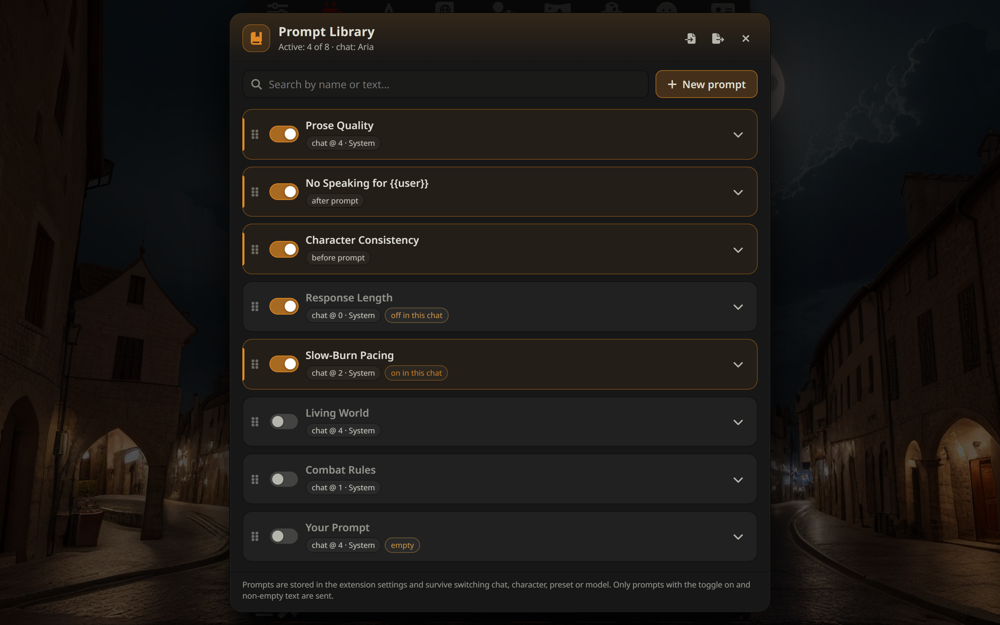
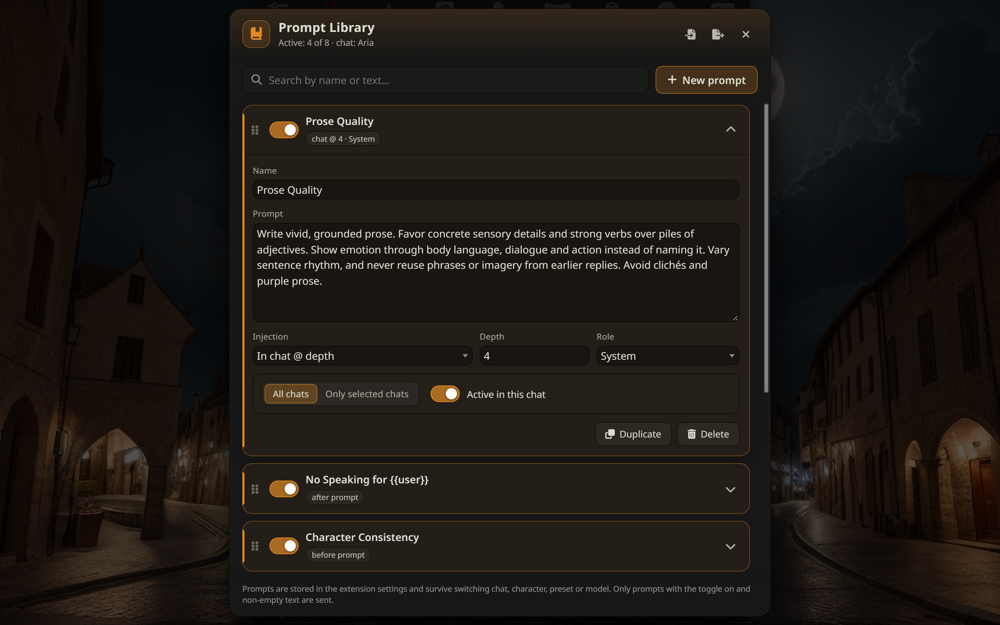
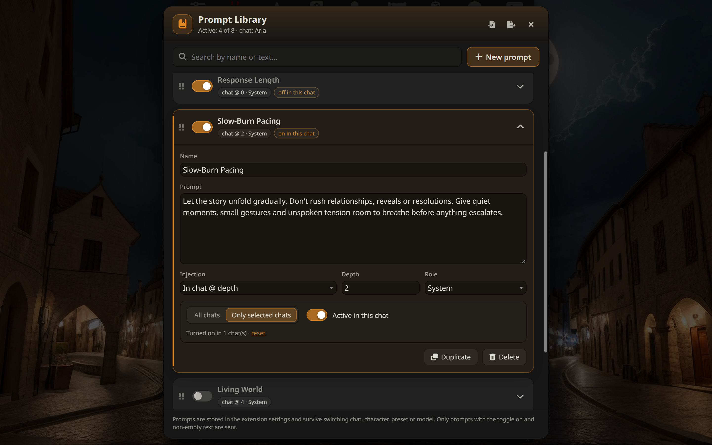
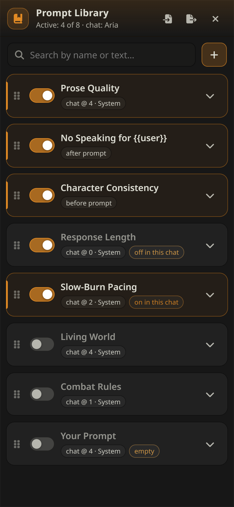
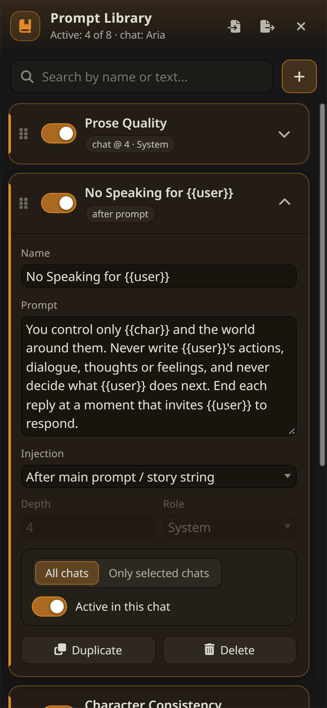

# Prompt Library для SillyTavern

[English](README.md)

Библиотека своих промтов. Это как Авторская заметка, только записей сколько угодно, и все лежат в одном месте. Промты хранятся в настройках расширения и не пропадают при смене чата, персонажа, пресета, API или модели.

## Возможности

- Отдельное окно из меню «палочки» (🪄 → **Библиотека промтов**).
- У каждой записи есть **тумблер**, **имя**, **текст промта**, **тип инжекта**, **глубина** и **роль**.
  - *В чате на глубине N*: как у Авторской заметки (0 — после последнего сообщения).
  - *Перед основным промтом* или *после основного промта*.
- При первом запуске в библиотеке одна пустая выключенная запись **Your Prompt**. Новые записи получают те же настройки инжекта, что и Авторская заметка по умолчанию: в чате, глубина 4, System (или то, что выставлено у тебя в Авторской заметке).
- Выключенная запись или запись с пустым текстом в запрос **не попадает**.
- По умолчанию запись действует **во всех чатах**. Внутри редактора есть тумблер «Активен в этом чате», чтобы выключить её только здесь. Режим «Только в выбранных» включает запись лишь в отмеченных чатах.
- Добавить, дублировать, удалить, перетащить для смены порядка, поиск по имени и тексту.
- Экспорт и импорт библиотеки в JSON (привязки к чатам не экспортируются).
- Макросы `{{char}}`, `{{user}}` и другие работают.
- Язык интерфейса совпадает с языком таверны: русский, украинский, английский, китайский (упрощённый; для традиционного тоже показывается упрощённый).
- Цвета берутся из активной темы, на телефоне окно открывается на весь экран.

## Установка

Расширения → Установить расширение → вставь ссылку:

```
https://github.com/Sumo1433/SillyTavern-Prompt-Library
```

## Как это работает

Расширение использует штатный механизм таверны `setExtensionPrompt`, тот же, что у Авторской заметки. Поэтому оно работает и в Chat Completion, и в Text Completion, с любым пресетом. Если в пресете выключен Main Prompt, «перед» и «после» основного промта всё равно встают на место.

## Тонкости

- Записи с одинаковым типом инжекта, глубиной и ролью уходят одним блоком в порядке библиотеки. Так порядок одинаков в Chat Completion и Text Completion.
- На одной глубине таверна всегда ставит роли в порядке System → User → Assistant, независимо от порядка в библиотеке.
- Роль действует только для «В чате на глубине». Записи перед и после основного промта всегда уходят как System.

## Скриншоты



| Редактор | Тумблер для чата |
| --- | --- |
|  |  |

| Телефон | Редактор на телефоне |
| --- | --- |
|  |  |

## Автор

**SumoNoir** — Telegram [@deadsum](https://t.me/deadsum). Лицензия MIT.
